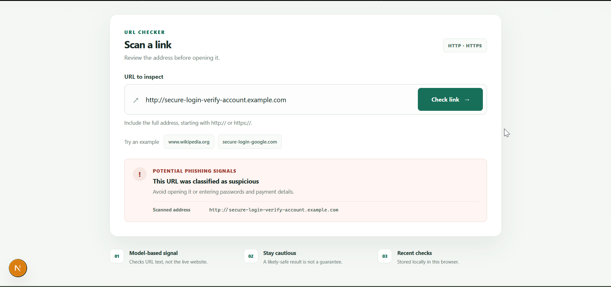
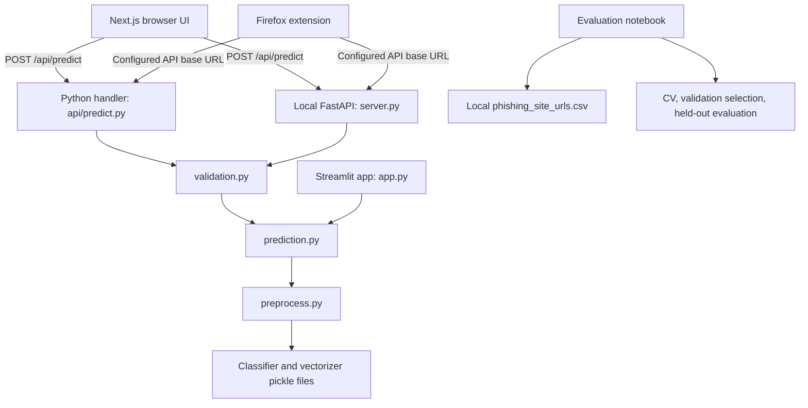

# LinkLens — URL Phishing Signal Checker

LinkLens classifies a submitted URL as `good` or `bad` using a text-based
machine-learning model. The Next.js interface can call a local FastAPI service
or a Python function under `api/`. A Firefox extension and a Streamlit interface
are also included.

> This is a URL classification signal, not a guarantee that a website is safe.
> LinkLens does not open or scan the destination website.

## Screenshots and demo



## Features

- Submit an HTTP or HTTPS URL from the Next.js interface.
- Show the classified result, the scanned address, and an uncertainty reminder.
- Keep up to 20 recent checks in browser `localStorage`; show the five newest
  and allow clearing the history.
- Call a local FastAPI API or a configured prediction API.
- Use the included Firefox popup to check a typed URL or the current tab.
- Run an optional Streamlit checker with session-scoped summary counts.
- Evaluate candidate models in the notebook with training-only cross-validation
  and validation-based selection.

## Technology stack

- **Web:** Next.js 16, React 19, TypeScript
- **Prediction API:** FastAPI, Pydantic, Uvicorn; Vercel-compatible handler in
  `api/predict.py`
- **Inference:** scikit-learn, NLTK, NumPy, and the included pickle artifacts
- **Optional tools:** Streamlit, pandas, Matplotlib, XGBoost, and Jupyter kernel
  support for the training/evaluation notebook
- **Browser extension:** Firefox Manifest V3 APIs

The checked-in `package-lock.json` pins the JavaScript dependency tree. Python
dependencies are pinned in `requirements.txt` and `requirements-dev.txt`.

## Architecture



The frontend sends the URL to its configured prediction API. The API validates
the URL, calls `prediction.py`, and returns a label. Inference requires both
`PhishingDomainDetection.pkl` and `vectorizer.pkl` at the project root; the
Python modules load them relative to their own source paths. The Streamlit app
calls the prediction module directly. The notebook evaluates models but does
not export a production model artifact.

## Machine-learning methodology

The notebook reads `phishing_site_urls.csv` from the project root. That dataset
is not included in the intended public repository. The notebook reports
507,194 usable unique URL rows after exact-URL deduplication and exclusion of
the documented URL group with conflicting labels. Exact URL strings are kept
within a single split; URLs sharing a domain may remain as distinct examples.

The evaluation uses a reproducible stratified 70/15/15 train, validation, and
test split with seed `42` (355,035 / 76,079 / 76,080 rows). It does not claim
temporal generalization because usable timestamps are unavailable. Text is
processed with `RegexpTokenizer(r"[A-Za-z]+")`, the English Snowball stemmer,
and `CountVectorizer`. Each cross-validation fold fits its own vectorizer using
only that fold's training rows.

The initial candidate set was Logistic Regression, LinearSVC, Decision Tree,
Random Forest, and XGBoost. Gradient Boosting was deferred. The searched grids
were Logistic Regression `C={0.1, 1, 10}`, LinearSVC `C={0.1, 1}`, Decision
Tree `max_depth={10, 25, None}`, Random Forest `n_estimators={100}` with
`max_depth={None, 25}`, and XGBoost `n_estimators={100}`, `max_depth={3, 6}`,
and `learning_rate={0.1}`.

Three-fold stratified cross-validation on training data selected candidate
parameters; validation phishing recall, then F1, then precision selected the
final candidate. No custom decision threshold or threshold tuning was used:
both validation and test predictions use the estimator's default `predict()`
policy. For LinearSVC, that is a margin-based decision boundary, not a
probability threshold.

### Evaluation results

The selected evaluation candidate was **`LinearSVC(C=1.0)`**. Its held-out test
validation metrics were phishing recall `0.909303`, F1 `0.935494`, and
precision `0.963238`. Its held-out test results were:

| Metric | Held-out test |
| --- | ---: |
| Accuracy | 0.970991 |
| Phishing precision | 0.962591 |
| Phishing recall | 0.906503 |
| Phishing F1 | 0.933706 |
| False negatives (phishing classified as `good`) | 1,603 |

Confusion matrix (actual labels are rows; predicted labels are columns):

| Actual label / predicted label | `good` | `bad` |
| --- | ---: | ---: |
| `good` | 58,331 | 604 |
| `bad` | 1,603 | 15,542 |

**These are evaluation results for LinearSVC, not for the model currently
served by the application.** The existing `PhishingDomainDetection.pkl` loads
as a `GridSearchCV` whose estimator is `sklearn.svm.SVC(kernel="linear")` with
`probability=False`. It has not been replaced by the selected LinearSVC. The
estimators are different, so the table above must not be represented as
production-app performance. The notebook's resumable workflow saves evaluation
checkpoints and metrics; this repository does not provide a verified command
to export the selected candidate to the production pickle paths.

## Installation and setup

Requirements verified from the project configuration:

- Python **3.13** (`.python-version`)
- Node.js **20.9 or later** (the installed Next.js package declares this minimum)
- npm

From the project root, create a Python environment and install the inference
dependencies. The commands below use PowerShell:

```powershell
py -3.13 -m venv .venv
.\.venv\Scripts\python.exe -m pip install --upgrade pip
.\.venv\Scripts\python.exe -m pip install -r requirements.txt
npm ci
```

On macOS or Linux, use `python3.13 -m venv .venv`, activate it with
`source .venv/bin/activate`, then run `python -m pip install -r requirements.txt`
and `npm ci`.

The two model artifacts must remain at the project root. They are required for
prediction and are not generated by the installation steps above.

For Streamlit and notebook dependencies, install the development requirements
as well:

```powershell
.\.venv\Scripts\python.exe -m pip install -r requirements-dev.txt
```

`requirements-dev.txt` includes `requirements.txt`. The training notebook also
expects `phishing_site_urls.csv` at the project root. The dataset is excluded
from this repository pending source and redistribution checks; no download
source or dataset license is currently documented. `ipykernel` is included,
but this repository does not install or configure a notebook front end. Open
the notebook in an existing Jupyter-compatible client and select this
environment as its kernel. The repository does not define a command to export
a trained model from the notebook.

## Run the application locally

Start the local FastAPI service in one terminal:

```powershell
.\.venv\Scripts\python.exe -m uvicorn server:app --reload --port 8000
```

Start Next.js in a second terminal. Set the API base URL so the frontend calls
the local FastAPI service:

```powershell
$env:NEXT_PUBLIC_PREDICTION_API_URL = "http://127.0.0.1:8000"
npm run dev
```

On macOS or Linux, use these commands in separate terminals:

```bash
.venv/bin/python -m uvicorn server:app --reload --port 8000
```

```bash
NEXT_PUBLIC_PREDICTION_API_URL=http://127.0.0.1:8000 npm run dev
```

Open <http://localhost:3000>. The local FastAPI service also provides
`GET /health` and retains `POST /predict` alongside `POST /api/predict`.
`ALLOWED_ORIGINS` is a comma-separated list for the FastAPI and Vercel handlers;
the local FastAPI defaults allow `localhost:3000` and `127.0.0.1:3000`.

To create a production frontend build, use:

```powershell
npm run build
npm run start
```

## Checks

Run the existing Python tests and frontend checks from the project root:

```powershell
.\.venv\Scripts\python.exe -m unittest discover -s tests -v
npm run typecheck
npm run build
```

The test suite uses Python's built-in `unittest` runner. No frontend test
framework is currently configured.

The repository includes `vercel.json` for the Python function under `api/`,
with a configured maximum duration of 15 seconds. A live deployment has not
been verified as part of this documentation.

## API usage

`POST /api/predict` accepts an HTTP or HTTPS URL up to 2,048 characters and
returns a label. The same request shape is used by the Vercel handler and local
FastAPI service.

PowerShell example:

```powershell
$body = @{ url = "https://example.com" } | ConvertTo-Json
Invoke-RestMethod `
  -Method Post `
  -Uri "http://127.0.0.1:8000/api/predict" `
  -ContentType "application/json" `
  -Body $body
```

Example response from the current local model artifact for that URL:

```json
{"label":"good"}
```

Other URLs may return `{"label":"bad"}`. A `good` result does not establish
that a site is safe. Invalid requests are rejected by the API; the local
FastAPI service returns standard FastAPI/Pydantic validation responses (HTTP
422 for invalid request data).

## Firefox extension

The Firefox Manifest V3 extension is in `extensions/firefox/`. Its current
popup title is **PhishSite Checker**. To load it temporarily:

1. Start the local FastAPI service, or choose an already-running API.
2. In Firefox, open `about:debugging#/runtime/this-firefox`.
3. Choose **Load Temporary Add-on…** and select
   `extensions/firefox/manifest.json`.
4. Open the popup and set **Prediction API** to the API origin, for example
   `http://127.0.0.1:8000` locally or your HTTPS API origin.
5. Enter a URL or choose **Use Current Tab**, then select **Check**. Grant the
   requested host permission when prompted.

The extension saves its API origin in Firefox local storage. For a
cross-origin deployment, configure the API's `ALLOWED_ORIGINS` as needed for
the extension origin. The extension has not been verified for Chrome.

## Streamlit application

The optional Streamlit checker and session dashboard are in `app.py`. Install
`requirements-dev.txt`, then run:

```powershell
.\.venv\Scripts\python.exe -m streamlit run app.py
```

The dashboard counters use Streamlit session state; they are not a shared or
persistent analytics service. The Streamlit app uses the same production
pickle artifacts as the prediction APIs.

## Project structure

```text
app/                         Next.js page and styles
api/predict.py               Vercel-compatible Python request handler
server.py                    Local FastAPI application
prediction.py                Loads the classifier and predicts
preprocess.py                Tokenizes, stems, and vectorizes URL text
validation.py                HTTP(S) URL validation
PhishingDomainDetection.pkl  Existing production classifier (required)
vectorizer.pkl               Existing production vectorizer (required)
app.py                       Optional Streamlit checker and dashboard
lottie_streamlit.py          Streamlit animation helper
extensions/firefox/          Firefox popup extension
PhishingDomainDetection.ipynb Training and evaluation notebook
tests/                       Python unittest coverage
requirements.txt             Python inference/API dependencies
requirements-dev.txt         Notebook and Streamlit dependencies
package.json                 Next.js scripts and dependencies
```

The training CSV, local `.env`, generated `evaluation_checkpoints/`, and local
build/cache directories are intentionally excluded from the planned public
repository.

## Limitations and responsible use

- The model classifies URL text; it does not load the site, inspect page
  content, check reputation feeds, or verify ownership and certificates.
- False negatives occur: the selected evaluation candidate missed 1,603
  phishing URLs in its held-out test set. Its metrics do not describe the
  currently served SVC artifact.
- A `good` label is not a guarantee. Verify the domain independently and do
  not enter credentials or payment information based only on this result.
- Submitted URLs are sent to the configured prediction API. The Next.js
  frontend stores recent check records in browser `localStorage`; clear them
  from the page when needed. Avoid submitting URLs containing private tokens or
  other sensitive query data.
- The dataset has no usable timestamp/source metadata for temporal evaluation.
  Results should not be interpreted as evidence of performance on future URL
  distributions.
- The current evaluation winner has not been exported to replace the existing
  production artifacts. Model and dataset redistribution terms also need
  confirmation before public release.
- A public deployment should add appropriate abuse controls and rate limiting.

## Future improvements

- Resolve dataset provenance and redistribution terms, then document a
  reproducible way to obtain the training data.
- Establish a reviewed process for aligning an evaluated model with the
  artifacts used for inference; report metrics for the deployed artifact only
  after that alignment is verified.
- Add real desktop/mobile screenshots and a verified demo link when available.
- Verify API integration and Firefox behavior in the intended release
  environment, and align the extension's existing title with the project when
  appropriate.
- Select and add a project license after confirming code, dataset, and artifact
  rights.

## License status

No license file is currently included. A public license has not been selected.
Dataset provenance and redistribution rights, as well as model artifact
redistribution rights, remain to be confirmed before release.
